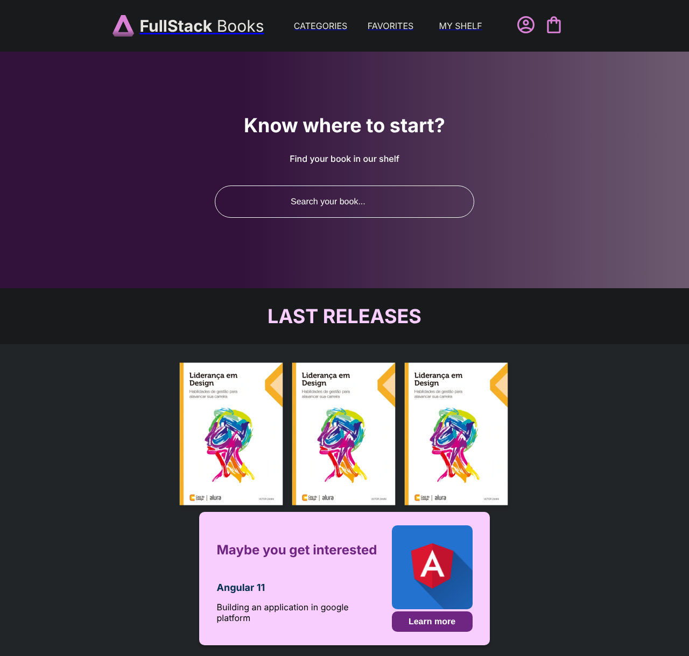

<div align="center">


# FullStack Books

**Online bookstore with a React front end and a Node.js API for searching books and managing favorites.**


[](LICENSE)

</div>

**English** · [Português](README.pt-BR.md)

> [!NOTE]
> Built while studying with [Alura](https://www.alura.com.br/)'s React and Node.js courses. The goal was to practice the whole flow: React components, an Express API and the integration between the two.



---

## About

The home page has a book search and a "last releases" showcase. Clicking a book in the search results adds it to your favorites, and the **Favorites** page lists them and lets you remove them. The front end reads and writes everything through an Express API, which persists data in JSON files.

## Features

- **Book search** filtered by name.
- **Add and remove favorites,** with the list kept on the server.
- **Two pages** (Home and Favorites) with React Router.
- **Full REST API for books** (list, get, create, update and delete), ready for an admin panel.

## Technical highlights

- **Layered API:** routes, controllers and services separated, with ID validation and proper status codes (`201` on creation, `422` for an invalid ID, `500` on failure).
- **Component-based front end** styled with styled-components and a global style via `createGlobalStyle`.
- **Service layer on the front end:** API calls isolated in `services/` with Axios instances, separate from the components.
- **File persistence:** the API reads and writes `books.json` and `favorites.json` with `fs`, keeping the focus on the HTTP layer without needing a database.

## Stack

| Layer | Technologies |
|---|---|
| Front end | React 18, React Router, styled-components, Axios (Create React App) |
| Back end | Node.js, Express, CORS |
| Persistence | JSON files |

## API routes

| Method | Route | Description |
|---|---|---|
| `GET` | `/books` | Lists books |
| `GET` | `/books/:id` | One book |
| `POST` | `/books` | Creates a book |
| `PATCH` | `/books/:id` | Updates a book |
| `DELETE` | `/books/:id` | Removes a book |
| `GET` | `/favorites` | Lists favorites |
| `POST` | `/favorites/:id` | Adds a book to favorites |
| `DELETE` | `/favorites/:id` | Removes a book from favorites |

## Running locally

Requirements: Node.js 18+.

```bash
git clone https://github.com/giobroliatto/fullstack-books.git
cd fullstack-books

# API (http://localhost:8000)
cd backend
npm install
npm run dev

# Front end (http://localhost:3000), in another terminal
cd frontend
npm install
npm start
```

## Structure

```
backend/
├── app.js           # Express, CORS and routes
├── routes/          # /books and /favorites
├── controllers/     # Validation and responses
├── services/        # Reading and writing the JSON files
├── books.json
└── favorites.json
frontend/src/
├── components/      # Header, Search, LastReleases, RecommendationCard...
├── routes/          # Home and Favorites pages
└── services/        # API calls with Axios
```

---

## License

[MIT](LICENSE)

---

## Author

Made by **Giovani Broliatto**.

[](https://www.linkedin.com/in/giobroliatto/)
